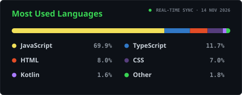
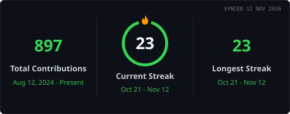
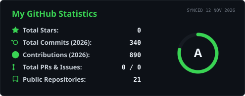

<!-- =========================================================
     TANMAY AGRAWAL | GITHUB PROFILE README
     Software Engineer | Backend · Full-Stack · Cloud
     Developer Brand: TanmayDevX
     Repository: tanmay-devx/tanmay-devx
========================================================== -->

<div align="center">


*Engineering scalable backend systems, distributed architectures, and reliable software products.*

<p align="center">
  <a href="https://tanmaydev.in" target="_blank">
    
  </a>
  &nbsp;
  <a href="https://www.linkedin.com/in/tanmayagrawaldev" target="_blank">
    
  </a>
  &nbsp;
  <a href="mailto:tanmayagrawal.dev@gmail.com">
    
  </a>
  &nbsp;
  <a href="https://github.com/tanmay-devx" target="_blank">
    
  </a>
</p>


</div>

## 01 · Executive Summary


<table width="100%">
<tr>
<td width="50%" valign="top">

#### Backend & Distributed Systems
Decoupled, event-driven services, async worker pipelines, and ACID relational persistence designed for horizontal scale.

`Node.js` `NestJS` `RabbitMQ` `PostgreSQL` `Prisma`

</td>
<td width="50%" valign="top">

#### Process Sandboxing & Security
Untrusted workload isolation with Rootless Podman, dropped Linux capabilities, strict `cgroups`, and zero-knowledge encryption.

`Rootless Podman` `Linux cgroups` `AES-256-GCM` `Web Crypto`

</td>
</tr>
<tr>
<td width="50%" valign="top">

#### Defensive Reliability
Manual AMQP consumer ACKs, bounded `100MB` memory streams, Redis TTL lifecycles, and offline-first local edge persistence.

`AMQP ACKs` `Circuit Breakers` `Redis` `SQLite`

</td>
<td width="50%" valign="top">

#### Cloud & Infrastructure
Reproducible AWS infrastructure (`EC2`, `S3`, `IAM`, `VPC`) provisioned declaratively with Terraform and multi-stage containers.

`AWS` `Terraform` `Docker` `GitHub Actions` `Linux`

</td>
</tr>
</table>

## 02 · Key Engineering Projects


<table width="100%">
<tr>
<td width="50%" valign="top">

### 01. CodVidya — Distributed Code Judge
*1st Place, Innotech Hackathon (400+ participants) · Asynchronous execution engine & isolated judge.*

- **Async Judge Pipeline:** Concurrent student submissions decoupled via RabbitMQ with manual consumer ACKs.
- **Rootless Isolation:** Untrusted code compiled and graded inside rootless Podman containers with strict resource caps.
- **Monorepo Layout:** Turborepo workspace unifying API gateway, worker service, and shared Prisma schemas.

`NestJS` `TypeScript` `RabbitMQ` `Podman` `PostgreSQL` `Prisma`

<p>
  
</p>

</td>
<td width="50%" valign="top">

### 02. [NijiSamvad — Encrypted Real-Time Mesh](https://github.com/tanmay-devx/NijiSamvad)
*Zero-knowledge communication and peer-to-peer WebRTC platform.*

- **Client Cryptography:** End-to-end `AES-256-GCM` encryption with `PBKDF2` (100k iterations) key derivation.
- **Zero-Knowledge Signaling:** Stateless Socket.IO relay with zero plaintext payload exposure on the server.
- **P2P Media Transport:** Direct peer-to-peer audio/video streaming over resilient WebRTC mesh topology.

`React` `Node.js` `Socket.IO` `WebRTC` `Web Crypto API`

<p>
  <a href="https://niji-samvad.vercel.app/" target="_blank">
    
  </a>
  &nbsp;
  <a href="https://github.com/tanmay-devx/NijiSamvad" target="_blank">
    
  </a>
</p>

</td>
</tr>
<tr>
<td width="50%" valign="top">

### 03. [DropX — Ephemeral Data Exchange](https://github.com/tanmay-devx/dropx)
*Accountless temporary cross-device file sharing platform.*

- **Ephemeral Lifecycle:** Real-time room synchronization and automated TTL eviction backed by Redis.
- **Bounded Streaming:** Raw Express buffer ingestion with enforced `100MB` memory ceilings.
- **Transit Privacy:** Client-side payload encryption applied before files enter local relay channels.

`Node.js` `Express.js` `Redis` `Socket.IO` `React`

<p>
  <a href="https://dropxio.vercel.app/" target="_blank">
    
  </a>
  &nbsp;
  <a href="https://github.com/tanmay-devx/dropx" target="_blank">
    
  </a>
</p>

</td>
<td width="50%" valign="top">

### 04. [Planrova — Local-First Study System](https://github.com/tanmay-devx/planrova)
*Offline-capable academic productivity ecosystem.*

- **Native Alarm Bridge:** Custom Android Kotlin `AlarmManager` (`setAlarmClock()`) bypassing OS Doze limits.
- **Offline-First Sync:** Durable local persistence paired with selective Cloud Firestore conflict reconciliation.
- **Multimodal OCR:** Groq Vision extraction pipeline digitizing handwritten study notes into structured plans.

`React Native` `Expo` `Kotlin` `Firestore` `Groq API`

<p>
  <a href="https://planrova.vercel.app/" target="_blank">
    
  </a>
  &nbsp;
  <a href="https://github.com/tanmay-devx/planrova" target="_blank">
    
  </a>
</p>

</td>
</tr>
<tr>
<td colspan="2" valign="top">

### 05. [Sanjeevni AI — Multimodal Intake Kiosk](https://github.com/tanmay-devx/Sanjeevni-AI)
*AI-assisted clinic intake kiosk with 3D anatomical interaction and localized edge storage.*

- **Edge Offline Persistence:** Local `better-sqlite3` write-ahead storage preserving patient intake logs during clinic network dropouts.
- **3D & 2D Symptom Mapping:** Interactive Three.js 3D avatar synchronized with 2D anatomical pain coordinate capture.
- **Multilingual Clinical Triage:** Hindi / Hinglish / English speech recognition synthesized into structured summaries via Groq LLaMA.

`React 18` `Three.js` `Node.js` `SQLite` `Groq LLaMA`

<p>
  <a href="https://sanjeevniai.vercel.app/" target="_blank">
    
  </a>
  &nbsp;
  <a href="https://github.com/tanmay-devx/Sanjeevni-AI" target="_blank">
    
  </a>
</p>

</td>
</tr>
</table>

## 03 · Verified Credentials & Honors


<table width="100%">
<tr>
<td width="54%" valign="top">

#### Cloud & AI Certifications

- **AWS Certified Cloud Practitioner** — *Amazon Web Services*  
  Core cloud infrastructure, IAM security, and Well-Architected principles.  
  <a href="https://cp.certmetrics.com/amazon/en/public/verify/credential/fac9701f985443a3a5cad85982cc6520" target="_blank"></a>

- **AWS Certified AI Practitioner** — *Amazon Web Services*  
  ML pipelines, foundation models, and responsible AI governance.  
  <a href="https://cp.certmetrics.com/amazon/en/public/verify/credential/4ad652a9eeee41e39af0dfabae4fcc8a" target="_blank"></a>

- **AWS Academy Graduate — Generative AI Foundations**  
  Large language model architectures and cloud-hosted inference pipelines.  
  <a href="https://www.credly.com/earner/earned/badge/ff32dd8b-470b-4dd4-b7da-536382d97959" target="_blank"></a>

</td>
<td width="46%" valign="top">

#### Engineering & Hackathon Honors

- **Innotech Hackathon**  
    
  Ranked **1st overall** presenting CodVidya's asynchronous RabbitMQ + Rootless Podman judging architecture.

- **NIT Jalandhar Hackathon**  
    
  Selected among the **Top 10 engineering teams** nationwide during a 36-hour build sprint.

</td>
</tr>
</table>

## 04 · One Engineer, Every Layer of a Distributed System


<div align="center">
  
</div>

## 05 · Problem Solving & Engineering Activity


<div align="center">

<p align="center">
  <a href="https://leetcode.com/u/tanmay041/" target="_blank">
    
  </a>
  &nbsp;
  <a href="https://codeforces.com/profile/tanmay0412" target="_blank">
    
  </a>
  &nbsp;
  <a href="https://www.codechef.com/users/tanmay041" target="_blank">
    
  </a>
  &nbsp;
  <a href="https://www.hackerrank.com/tanmay041" target="_blank">
    
  </a>
</p>

<table width="100%">
<tr>
  <td width="50%" align="center">
    <a href="https://leetcode.com/u/tanmay041/">
      
    </a>
  </td>
  <td width="50%" align="center">
    <a href="https://github.com/tanmay-devx?tab=repositories">
      
    </a>
  </td>
</tr>
<tr>
  <td width="50%" align="center">
    <a href="https://github.com/tanmay-devx">
      
    </a>
  </td>
  <td width="50%" align="center">
    <a href="https://github.com/tanmay-devx">
      
    </a>
  </td>
</tr>
</table>

<br/>


</div>

---

<div align="center">

<p align="center">
  <a href="https://tanmaydev.in"><b>Portfolio</b></a> &bull;
  <a href="https://www.linkedin.com/in/tanmayagrawaldev"><b>LinkedIn</b></a> &bull;
  <a href="mailto:tanmayagrawal.dev@gmail.com"><b>tanmayagrawal.dev@gmail.com</b></a> &bull;
  <a href="https://github.com/tanmay-devx"><b>GitHub</b></a>
</p>

```
$ echo "Good software engineering is understanding the trade-offs behind why it works."
```

</div>
