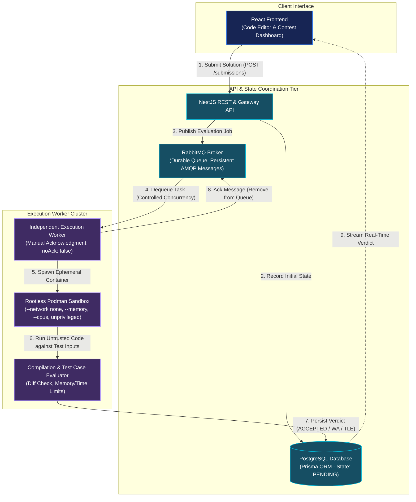
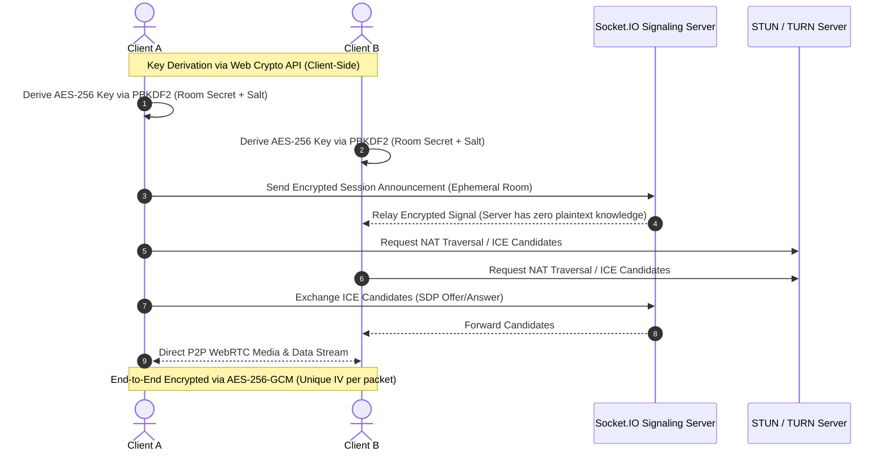

<!-- =========================================================
     TANMAY AGRAWAL | GITHUB PROFILE README
     Production Engineering Portfolio & Systems Architecture
     Repository: tanmay9783/tanmay9783
========================================================== -->

<div align="center">


### Full-Stack & Backend Systems Engineer

Building reliable backend services, asynchronous execution pipelines, and distributed architectures.

<p align="center">
  <a href="https://tanmaydevs.vercel.app" target="_blank">
    
  </a>
  &nbsp;
  <a href="https://www.linkedin.com/in/tanmay041/" target="_blank">
    
  </a>
  &nbsp;
  <a href="mailto:tanmayag041@gmail.com">
    
  </a>
  &nbsp;
  <a href="https://leetcode.com/u/tanmay041/" target="_blank">
    
  </a>
</p>


</div>

---

## 📌 `$ whoami`

I'm **Tanmay Agrawal**, an Information Technology undergraduate specializing in **backend systems, distributed architectures, and cloud infrastructure**.

My engineering focus lies beneath the user interface — in decoupled service communication, asynchronous message queues, process sandboxing, cryptographic privacy, and database durability. I prioritize clean API contracts, defensive system design, and defensible architectural choices over superficial complexity.

- **Systems & Asynchronous Architectures:** Decoupling compute-heavy workflows via message brokers (RabbitMQ), background worker pools, and event-driven communication.
- **Process Isolation & Security:** Running untrusted code inside sandboxed environments (Rootless Podman) with restricted namespaces, dropped capabilities, and strict cgroup quotas.
- **Data Engineering & Persistence:** Designing relational schemas with PostgreSQL and Prisma, low-latency caching with Redis / Valkey, and edge storage with SQLite.
- **Cloud & Infrastructure as Code:** Provisioning reproducible cloud environments using AWS (EC2, S3, IAM, VPC), Linux systems, Docker, and Terraform.

---

## 🏆 Honors, Awards & Verified Certifications

<table width="100%">
<tr>
<td width="50%" valign="top">

### 🥇 Innotech Hackathon — 1st Place Winner
Secured **1st Place among 400+ competitors** with our three-member team, architecting and building **CodVidya** — an asynchronous competitive coding platform and grading engine.

</td>
<td width="50%" valign="top">

### 🏅 NIT Jalandhar Hackathon — Top 10 Finalist
Ranked in the **Top 10 out of 100+ competing engineering teams** across India, architecting and delivering real-time distributed software during a 36-hour sprint.

</td>
</tr>
<tr>
<td width="50%" valign="top">

### ☁️ AWS Certified Cloud Practitioner
Validated foundational cloud infrastructure, IAM security policies, VPC networking, and AWS Well-Architected Framework design principles.  
🔗 [**Verify AWS Credential →**](https://cp.certmetrics.com/amazon/en/public/verify/credential/fac9701f985443a3a5cad85982cc6520)

</td>
<td width="50%" valign="top">

### 🤖 AWS Certified AI Practitioner
Validated machine learning architectures, cloud AI services, generative AI evaluation, and responsible AI governance.  
🔗 [**Verify AWS Credential →**](https://cp.certmetrics.com/amazon/en/public/verify/credential/4ad652a9eeee41e39af0dfabae4fcc8a)

</td>
</tr>
<tr>
<td colspan="2" valign="top">

### 📜 AWS Academy Graduate — Generative AI Foundations
Demonstrated proficiency in large language model pipelines, prompt engineering patterns, and cloud-hosted LLM inference services.  
🔗 [**Verify Credly Badge →**](https://www.credly.com/earner/earned/badge/ff32dd8b-470b-4dd4-b7da-536382d97959)

</td>
</tr>
</table>

---

## 🛠️ Technical Arsenal

<table>
<tr>
  <td width="24%"><strong>Programming Languages</strong></td>
  <td>
    <a href="https://skillicons.dev"></a>
    <br/>
    <sub>TypeScript · JavaScript (ES6+) · Java · Python · C · C++ · SQL</sub>
  </td>
</tr>
<tr>
  <td><strong>Backend & Real-Time</strong></td>
  <td>
    <a href="https://skillicons.dev"></a>
    <br/>
    <sub>Node.js · Express.js · NestJS · RESTful APIs · Socket.IO · WebRTC</sub>
  </td>
</tr>
<tr>
  <td><strong>Queues & Databases</strong></td>
  <td>
    <a href="https://skillicons.dev"></a>
    <br/>
    <sub>PostgreSQL · Redis / Valkey · RabbitMQ (AMQP) · MongoDB · SQLite (better-sqlite3) · Prisma ORM</sub>
  </td>
</tr>
<tr>
  <td><strong>Cloud, DevOps & Security</strong></td>
  <td>
    <a href="https://skillicons.dev"></a>
    <br/>
    <sub>AWS (EC2, S3, IAM, VPC) · Docker · Rootless Podman · Terraform · Linux Systems · GitHub Actions · Git</sub>
  </td>
</tr>
<tr>
  <td><strong>Frontend & Mobile</strong></td>
  <td>
    <a href="https://skillicons.dev"></a>
    <br/>
    <sub>React · Next.js · React Native (Expo) · Tailwind CSS · Vite · Three.js · Kotlin Native Bridge</sub>
  </td>
</tr>
</table>

> **Currently Deepening & Exploring:** Kubernetes pod lifecycles & ingress controllers, distributed consensus (Raft), database horizontal sharding, and advanced graph algorithms.

---

## 🚀 Featured Engineering Projects

A curated selection of systems where I addressed real scalability bottlenecks, security isolation boundaries, and architectural trade-offs.

<table width="100%">
<tr>
<td width="50%" valign="top">

<a href="https://github.com/tanmay9783/Coditorium">
  
</a>

### 01. CodVidya — Asynchronous Code Assessment Engine
*Flagship Distributed System & Judging Platform*

- **The Problem:** Ingesting untrusted student code on shared application hosts risks fork bombs, resource exhaustion, and privilege escalation, while synchronous execution creates severe API blocking during high-volume contests.
- **Architectural Solution:** Built a decoupled submission pipeline. A NestJS API persists submissions into PostgreSQL and publishes evaluation events to RabbitMQ. An isolated worker pool consumes tasks and executes code within rootless Podman sandboxes with disabled networking and strict CPU/RAM limits.
- **Key Engineering Highlights:**
  - RabbitMQ AMQP with durable queues (`{ durable: true }`), persistent delivery (`{ persistent: true }`), and explicit manual acknowledgments (`{ noAck: false }`).
  - Secure jail execution with Rootless Podman (`--network none`, `--cpus`, `--memory`, dropped root capabilities).
  - Turborepo monorepo architecture separating API, execution worker, and shared schema contracts.
- **Tech Stack:** `NestJS` · `TypeScript` · `PostgreSQL` · `RabbitMQ` · `Podman` · `Prisma`

🔗 [**Explore GitHub Repository →**](https://github.com/tanmay9783/Coditorium)

</td>
<td width="50%" valign="top">

<a href="https://github.com/tanmay9783/NijiSamvad">
  
</a>

### 02. NijiSamvad — Client-Side Encrypted Communication Mesh
*Zero-Knowledge Real-Time Messaging & WebRTC Platform*

- **The Problem:** Centralized messaging servers typically have access to chat payloads and room media, introducing single-point data breach risks and privacy compromises.
- **Architectural Solution:** Designed an ephemeral communication system utilizing client-side cryptography and peer-to-peer WebRTC mesh. The signaling server handles connection handshakes in a purely stateless manner without storing or decrypting messages.
- **Key Engineering Highlights:**
  - Symmetric key derivation from room secrets using PBKDF2 (100,000 iterations + SHA-256) via the Web Crypto API.
  - End-to-end payload encryption using AES-256-GCM with unique random 96-bit initialization vectors (IVs) per transmission.
  - Direct P2P audio/video streaming via WebRTC mesh with dynamic ICE candidate negotiation.
- **Tech Stack:** `React` · `Node.js` · `Socket.IO` · `WebRTC` · `Web Crypto API`

🔗 [**Explore GitHub Repository →**](https://github.com/tanmay9783/NijiSamvad)

</td>
</tr>
<tr>
<td width="50%" valign="top">

<a href="https://github.com/tanmay9783/dropx">
  
</a>

### 03. DropX — Ephemeral Cross-Device Data Exchange
*Accountless Real-Time File & Text Transfer Platform*

- **The Problem:** Transferring quick files and text snippets between disparate devices often requires tedious account registrations, permanent third-party storage, or exposed credentials.
- **Architectural Solution:** Created a lightweight, registration-free transfer engine utilizing short-lived session rooms, QR code pairing, and automatic TTL expiration.
- **Key Engineering Highlights:**
  - Redis-backed session management with millisecond-accurate TTL invalidation to guarantee zero lingering artifacts.
  - Express raw buffer payload handling with an enforced 100MB ceiling and rate-limiting to prevent memory exhaustion.
  - Client-side AES-256-GCM encryption for payload privacy before transit.
- **Tech Stack:** `Node.js` · `Express.js` · `Redis` · `Socket.IO` · `React`

🔗 [**Explore GitHub Repository →**](https://github.com/tanmay9783/dropx)

</td>
<td width="50%" valign="top">

<a href="https://github.com/tanmay9783/planrova">
  
</a>

### 04. Planrova — Local-First Academic Productivity System
*Offline-First Mobile & Web Study Workflow Platform*

- **The Problem:** Student productivity tools frequently fail when network connectivity is intermittent, and JavaScript timer hooks get killed when mobile operating systems enter low-power sleep states.
- **Architectural Solution:** Built a local-first ecosystem featuring a zero-virtual-DOM desktop client, an Expo mobile application, and a custom native Android Kotlin bridge for reliable system-level alarms.
- **Key Engineering Highlights:**
  - Native Android Kotlin `AlarmManager` integration (`setAlarmClock()` and Foreground Services) to minimize timer suppression during OS Doze states.
  - Local-first offline persistence with selective Cloud Firestore synchronization when online.
  - Multimodal Groq Vision OCR integration for digitizing handwritten study notes into structured tasks.
- **Tech Stack:** `React Native (Expo)` · `Kotlin` · `Cloud Firestore` · `Groq Vision API`

🔗 [**Explore GitHub Repository →**](https://github.com/tanmay9783/planrova)

</td>
</tr>
<tr>
<td colspan="2" valign="top">

<a href="https://github.com/tanmay9783/Sanjeevni-AI">
  
</a>

### 05. Sanjeevni AI — Multimodal Patient Intake Kiosk
*AI-Assisted Clinic Intake Kiosk with 3D Interaction & Local-First Storage*

- **The Problem:** High patient volumes in community health clinics lead to diagnostic backlogs and extended waiting periods, where clinical staff spend significant time taking repetitive symptom histories from low-literacy patients.
- **Architectural Solution:** Built an interactive clinic intake kiosk featuring an interactive 3D virtual assistant, multilingual speech recognition (Hindi / Hinglish / English), and a 2D anatomical pain map with local-first edge storage.
- **Key Engineering Highlights:**
  - Local-first SQLite (`better-sqlite3`) storage on the kiosk node to persist demographic inputs and symptom logs without requiring continuous cloud connectivity.
  - Interactive 2D anatomical SVG body map with 1–10 pain severity sliders converting patient touch inputs into structured anatomical coordinates.
  - Generates clinical SOAP summaries for attending physicians, designed to integrate with companion medical systems.
- **Tech Stack:** `React 18` · `Three.js` · `Node.js (Express)` · `SQLite (better-sqlite3)` · `Groq LLaMA 3.3`

🔗 [**Explore GitHub Repository →**](https://github.com/tanmay9783/Sanjeevni-AI)

</td>
</tr>
</table>

---

## ⚙️ Systems Architecture Spotlight

### CodVidya — Asynchronous Submission & Judging Pipeline

The diagram below details the decoupled execution architecture designed to process untrusted code submissions safely under heavy concurrency without impacting user API response times:



---

### NijiSamvad — Zero-Knowledge Cryptographic Handshake

The sequence below illustrates the client-side cryptographic key derivation and peer-to-peer establishment where intermediate servers have zero visibility into user plaintexts:



---

## 🧠 Defensive Engineering & Trade-Off Philosophy

Good software engineering is not about blindly stacking libraries; it's about making defensible decisions and understanding system constraints:

1. **Decouple Ingestion from Compute:** Never execute long-running tasks synchronously in an API lifecycle. Offloading to RabbitMQ ensures APIs respond in single-digit milliseconds regardless of downstream compilation workloads.
2. **Mitigate Host Surface via Least Privilege:** Unprivileged users should never run rootful Docker daemons on evaluation hosts. Rootless Podman mitigates privilege escalation by mapping container root to an unprivileged host UID.
3. **Graceful Failure over Silent Data Loss:** Employ durable queue configurations and manual consumer acknowledgments. If an execution worker crashes mid-evaluation, the message is requeued and picked up by a healthy worker instead of being dropped.
4. **Transparent Engineering Limitations:** No system has infinite scalability. We document explicit boundaries:
   - *CodVidya:* Cold-start container invocation latency per submission; warm pre-forking is the designated roadmap enhancement.
   - *NijiSamvad:* Symmetric derivation from room secrets without an asymmetric Double Ratchet protocol (Signal Protocol); does not provide forward secrecy.
   - *DropX:* In-memory buffering ceiling enforced at 100MB via `express.raw()` rather than chunked streaming.

---

## 🧮 Competitive Programming & Algorithmic Problem Solving

Consistent practice in data structures, amortized complexity, and algorithmic problem-solving:

<div align="center">

<p align="center">
  <a href="https://leetcode.com/u/tanmay041/" target="_blank">
    
  </a>
  &nbsp;
  <a href="https://codeforces.com/profile/tanmay0412" target="_blank">
    
  </a>
  &nbsp;
  <a href="https://www.codechef.com/users/tanmay041" target="_blank">
    
  </a>
  &nbsp;
  <a href="https://www.hackerrank.com/tanmay041" target="_blank">
    
  </a>
</p>

<table width="100%">
<tr>
  <td width="50%" align="center">
    <a href="https://leetcode.com/u/tanmay041/">
      
    </a>
  </td>
  <td width="50%" align="center">
    <a href="https://codeforces.com/profile/tanmay0412">
      
    </a>
  </td>
</tr>
</table>

</div>

---

## 📊 GitHub Analytics & Engineering Velocity

<div align="center">

<table width="100%">
<tr>
  <td width="50%" align="center">
    
  </td>
  <td width="50%" align="center">
    
  </td>
</tr>
</table>

<div style="margin-top: 10px;">
  
</div>

<div style="margin-top: 25px;">
  <h4>Contribution Grid Activity</h4>
  <picture>
    <source media="(prefers-color-scheme: dark)" srcset="https://raw.githubusercontent.com/tanmay9783/tanmay9783/output/github-contribution-grid-snake-dark.svg">
    <source media="(prefers-color-scheme: light)" srcset="https://raw.githubusercontent.com/tanmay9783/tanmay9783/output/github-contribution-grid-snake.svg">
    
  </picture>
  <br/>
  <sub><em>Automated daily contribution snake generated via GitHub Actions.</em></sub>
</div>

</div>

---

<div align="center">

### 🤝 Let's Connect & Build Something Impactful

Whether you're looking for a backend engineer, discussing distributed systems architecture, or collaborating on innovative software:

<p align="center">
  <a href="https://tanmaydevs.vercel.app"><b>Portfolio Website</b></a> •
  <a href="https://www.linkedin.com/in/tanmay041/"><b>LinkedIn Profile</b></a> •
  <a href="mailto:tanmayag041@gmail.com"><b>tanmayag041@gmail.com</b></a> •
  <a href="https://github.com/tanmay9783"><b>GitHub Profile</b></a>
</p>

```
$ echo "Good software engineering is understanding the trade-offs behind why it works."
```

</div>
