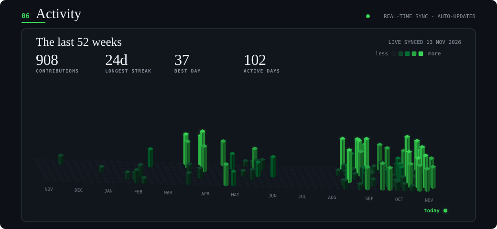

<!-- =========================================================
     TANMAY AGRAWAL | GITHUB PROFILE README
     Backend Systems & Distributed Architecture
     Repository: tanmay9783/tanmay9783
========================================================== -->

<div align="center">


### Backend & Systems Engineer
*Designing resilient backend architectures, asynchronous processing pipelines, and distributed systems.*

<p align="center">
  <a href="https://tanmaydevs.vercel.app" target="_blank">
    
  </a>
  &nbsp;
  <a href="https://www.linkedin.com/in/tanmaydevx/" target="_blank">
    
  </a>
  &nbsp;
  <a href="mailto:tanmayagrawal.dev@gmail.com">
    
  </a>
  &nbsp;
  <a href="https://leetcode.com/u/tanmay041/" target="_blank">
    
  </a>
  &nbsp;
  <a href="https://github.com/tanmay-devx">
    
  </a>
</p>


</div>

---

## 📌 Executive Summary

- **Backend & Distributed Systems:** Building decoupled, event-driven services using Node.js, NestJS, RabbitMQ, and PostgreSQL.
- **Process Sandboxing & Security:** Isolating untrusted execution environments using Rootless Podman with dropped capabilities and Linux cgroups.
- **Defensive Engineering:** Implementing manual consumer acknowledgments, circuit breakers, and bounded memory streaming over superficial abstractions.
- **Cloud & Infrastructure:** Provisioning reproducible environments on AWS (EC2, S3, IAM, VPC) with Terraform and Docker.

---

## 🚀 Key Engineering Projects

<table>
<tr>
<td width="50%" valign="top">

### 01. [CodVidya — Distributed Code Judge](https://github.com/tanmay9783/Coditorium)
*Asynchronous execution engine and evaluation platform.*

- Decoupled judge pipeline handling concurrent student submissions via RabbitMQ.
- Sandboxed compilation and test-case grading inside rootless Podman containers.
- Turborepo monorepo structuring API, worker service, and shared schemas.

`NestJS` `TypeScript` `RabbitMQ` `Podman` `PostgreSQL` `Prisma`

</td>
<td width="50%" valign="top">

### 02. [NijiSamvad — Encrypted Real-Time Mesh](https://github.com/tanmay9783/NijiSamvad)
*Zero-knowledge communication and P2P WebRTC platform.*

- Client-side AES-256-GCM encryption with PBKDF2 (100k iterations) key derivation.
- Stateless WebSocket signaling server with zero plaintext exposure.
- Direct peer-to-peer audio/video streaming over WebRTC mesh.

`React` `Node.js` `Socket.IO` `WebRTC` `Web Crypto API`

</td>
</tr>
<tr>
<td width="50%" valign="top">

### 03. [DropX — Ephemeral Data Exchange](https://github.com/tanmay9783/dropx)
*Accountless temporary cross-device file sharing platform.*

- Session synchronization and automated TTL data cleanup backed by Redis.
- Express raw buffer payload handling with enforced 100MB memory ceilings.
- End-to-end payload encryption before local transit.

`Node.js` `Express.js` `Redis` `Socket.IO` `React`

</td>
<td width="50%" valign="top">

### 04. [Planrova — Local-First Study System](https://github.com/tanmay9783/planrova)
*Offline-capable academic productivity ecosystem.*

- Custom Android Kotlin `AlarmManager` bridge (`setAlarmClock()`) bypassing OS Doze limits.
- Local-first offline persistence with selective Cloud Firestore synchronization.
- Multimodal Groq Vision OCR pipeline for study note digitization.

`React Native` `Expo` `Kotlin` `Firestore` `Groq API`

</td>
</tr>
<tr>
<td colspan="2" valign="top">

### 05. [Sanjeevni AI — Multimodal Intake Kiosk](https://github.com/tanmay9783/Sanjeevni-AI)
*AI-assisted clinic intake kiosk with 3D interaction and localized edge storage.*

- Edge-deployed SQLite (`better-sqlite3`) persisting intake logs during network dropouts.
- Interactive 3D avatar (Three.js) and 2D anatomical pain coordinate mapping.
- Multilingual speech recognition (Hindi / Hinglish / English) with Groq LLaMA clinical summaries.

`React 18` `Three.js` `Node.js` `SQLite` `Groq LLaMA`

</td>
</tr>
</table>

---

## 🏆 Verified Credentials & Honors

<table width="100%">
<tr>
<td width="50%" valign="top">

#### ☁️ AWS Certified Cloud Practitioner
Amazon Web Services &bull; Validated core cloud infrastructure, IAM security, and Well-Architected Framework principles.  
🔗 [**Verify AWS Credential →**](https://cp.certmetrics.com/amazon/en/public/verify/credential/fac9701f985443a3a5cad85982cc6520)

</td>
<td width="50%" valign="top">

#### 🤖 AWS Certified AI Practitioner
Amazon Web Services &bull; Validated machine learning pipelines, cloud AI services, and responsible AI governance.  
🔗 [**Verify AWS Credential →**](https://cp.certmetrics.com/amazon/en/public/verify/credential/4ad652a9eeee41e39af0dfabae4fcc8a)

</td>
</tr>
<tr>
<td width="50%" valign="top">

#### 🥇 Innotech Hackathon — 1st Place Winner
Ranked **1st among 400+ participants** with our team, presenting CodVidya's asynchronous judging architecture.

</td>
<td width="50%" valign="top">

#### 🏅 NIT Jalandhar Hackathon — Top 10 Finalist
Selected in the **Top 10 out of 100+ competing engineering teams** across India in a 36-hour sprint.

</td>
</tr>
<tr>
<td colspan="2" valign="top">

#### 📜 AWS Academy Graduate — Generative AI Foundations
Demonstrated proficiency in large language model architectures and cloud-hosted inference pipelines.  
🔗 [**Verify Credly Badge →**](https://www.credly.com/earner/earned/badge/ff32dd8b-470b-4dd4-b7da-536382d97959)

</td>
</tr>
</table>

---

## 🛠️ One Engineer, Every Layer of a Distributed System

<div align="center">
  
</div>

---

## 🧮 Problem Solving & Engineering Activity

<div align="center">

<p align="center">
  <a href="https://leetcode.com/u/tanmay041/" target="_blank">
    
  </a>
  &nbsp;
  <a href="https://codeforces.com/profile/tanmay0412" target="_blank">
    
  </a>
  &nbsp;
  <a href="https://www.codechef.com/users/tanmay041" target="_blank">
    
  </a>
  &nbsp;
  <a href="https://www.hackerrank.com/tanmay041" target="_blank">
    
  </a>
</p>

<table width="100%">
<tr>
  <td width="50%" align="center">
    <a href="https://leetcode.com/u/tanmay041/">
      
    </a>
  </td>
  <td width="50%" align="center">
    <a href="https://codeforces.com/profile/tanmay0412">
      
    </a>
  </td>
</tr>
<tr>
  <td width="50%" align="center">
    
  </td>
  <td width="50%" align="center">
    
  </td>
</tr>
</table>

<div style="margin-top: 25px;">
  
</div>

</div>

---

<div align="center">

<p align="center">
  <a href="https://tanmaydevs.vercel.app"><b>Portfolio Website</b></a> &bull;
  <a href="https://www.linkedin.com/in/tanmay041/"><b>LinkedIn</b></a> &bull;
  <a href="mailto:tanmayag041@gmail.com"><b>tanmayag041@gmail.com</b></a> &bull;
  <a href="https://github.com/tanmay9783"><b>GitHub</b></a>
</p>

```
$ echo "Good software engineering is understanding the trade-offs behind why it works."
```

</div>
