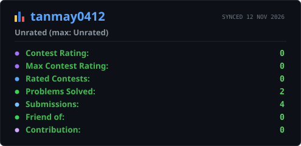

<!-- =========================================================
     TANMAY AGRAWAL | GITHUB PROFILE README
     Software Engineer | Backend · Full-Stack · Cloud
     Developer Brand: TanmayDevX
     Repository: tanmay-devx/tanmay-devx
========================================================== -->

<div align="center">


### Software Engineer | Backend · Full-Stack · Cloud
*Engineering scalable backend systems, distributed architectures, and reliable software products.*

<p align="center">
  <a href="https://tanmaydev.in" target="_blank">
    
  </a>
  &nbsp;
  <a href="https://www.linkedin.com/in/tanmayagrawaldev" target="_blank">
    
  </a>
  &nbsp;
  <a href="mailto:tanmayagrawal.dev@gmail.com">
    
  </a>
  &nbsp;
  <a href="https://leetcode.com/u/tanmay041/" target="_blank">
    
  </a>
  &nbsp;
  <a href="https://github.com/tanmay-devx">
    
  </a>
</p>


</div>

---

<div align="center">
  
</div>

---

<div align="center">
  
</div>

<table>
<tr>
<td width="50%" valign="top">

### 01. [CodVidya — Distributed Code Judge](https://github.com/tanmay-devx/Coditorium)
*Asynchronous execution engine and isolated grading platform.*

- Decoupled **RabbitMQ** judge queue handling concurrent submissions with manual ACKs.
- Sandboxed compilation and execution inside **Rootless Podman** containers with cgroup limits.
- **Turborepo** monorepo unifying API gateway, worker service, and shared Prisma schemas.

<details>
<summary>⚡ Architecture &amp; Pipeline Flow</summary>

`Client → NestJS API → RabbitMQ Queue → Rootless Podman Worker → PostgreSQL`

</details>

`NestJS` `TypeScript` `RabbitMQ` `Podman` `PostgreSQL` `Prisma`

<p>
  <a href="https://github.com/tanmay-devx/Coditorium" target="_blank">
    
  </a>
</p>

</td>
<td width="50%" valign="top">

### 02. [NijiSamvad — Encrypted Real-Time Mesh](https://github.com/tanmay-devx/NijiSamvad)
*Zero-knowledge communication and peer-to-peer WebRTC platform.*

- Client-side **AES-256-GCM** encryption with **PBKDF2 (100k iterations)** key derivation.
- Stateless **Socket.IO** signaling server guaranteeing zero plaintext server exposure.
- Direct peer-to-peer audio/video streaming over resilient **WebRTC** mesh topology.

<details>
<summary>⚡ Architecture &amp; Pipeline Flow</summary>

`Web Crypto (AES-GCM) → Stateless Socket.IO Signaling ↔ P2P WebRTC Mesh`

</details>

`React` `Node.js` `Socket.IO` `WebRTC` `Web Crypto API`

<p>
  <a href="https://niji-samvad.vercel.app/" target="_blank">
    
  </a>
  &nbsp;
  <a href="https://github.com/tanmay-devx/NijiSamvad" target="_blank">
    
  </a>
</p>

</td>
</tr>
<tr>
<td width="50%" valign="top">

### 03. [DropX — Ephemeral Data Exchange](https://github.com/tanmay-devx/dropx)
*Accountless temporary cross-device file sharing platform.*

- Automated **Redis** TTL session lifecycle and ephemeral room cleanup.
- Raw Express buffer streaming with enforced **100MB** bounded memory ceilings.
- End-to-end client-side payload encryption prior to local transit.

<details>
<summary>⚡ Architecture &amp; Pipeline Flow</summary>

`Encrypted Buffer → Express 100MB Stream → Socket.IO Room + Redis TTL`

</details>

`Node.js` `Express.js` `Redis` `Socket.IO` `React`

<p>
  <a href="https://dropxio.vercel.app/" target="_blank">
    
  </a>
  &nbsp;
  <a href="https://github.com/tanmay-devx/dropx" target="_blank">
    
  </a>
</p>

</td>
<td width="50%" valign="top">

### 04. [Planrova — Local-First Study System](https://github.com/tanmay-devx/planrova)
*Offline-capable academic productivity ecosystem.*

- Native Android Kotlin **AlarmManager** (`setAlarmClock()`) bridge bypassing OS Doze limits.
- Local-first offline persistence paired with selective **Cloud Firestore** sync.
- Multimodal **Groq Vision OCR** pipeline converting handwritten notes into structured tasks.

<details>
<summary>⚡ Architecture &amp; Pipeline Flow</summary>

`Local Store ⇄ Firestore Sync · Kotlin AlarmManager · Groq Vision OCR`

</details>

`React Native` `Expo` `Kotlin` `Firestore` `Groq API`

<p>
  <a href="https://planrova.vercel.app/" target="_blank">
    
  </a>
  &nbsp;
  <a href="https://github.com/tanmay-devx/planrova" target="_blank">
    
  </a>
</p>

</td>
</tr>
<tr>
<td colspan="2" valign="top">

### 05. [Sanjeevni AI — Multimodal Intake Kiosk](https://github.com/tanmay-devx/Sanjeevni-AI)
*AI-assisted clinic intake kiosk with 3D interaction and localized edge storage.*

- Edge-deployed **SQLite (`better-sqlite3`)** persisting patient intake logs during network dropouts.
- Interactive **Three.js** 3D anatomical avatar and 2D pain coordinate mapping.
- Multilingual voice intake (**Hindi / Hinglish / English**) synthesized via **Groq LLaMA** clinical summaries.

<details>
<summary>⚡ Architecture &amp; Pipeline Flow</summary>

`Voice + 3D Anatomy UI → Node.js Edge API → SQLite Offline Store + Groq LLaMA Triage`

</details>

`React 18` `Three.js` `Node.js` `SQLite` `Groq LLaMA`

<p>
  <a href="https://sanjeevniai.vercel.app/" target="_blank">
    
  </a>
  &nbsp;
  <a href="https://github.com/tanmay-devx/Sanjeevni-AI" target="_blank">
    
  </a>
</p>

</td>
</tr>
</table>

---

<div align="center">
  
</div>

<table width="100%">
<tr>
  <td width="50%" valign="top">
    <a href="https://cp.certmetrics.com/amazon/en/public/verify/credential/fac9701f985443a3a5cad85982cc6520" target="_blank">
      
    </a>
  </td>
  <td width="50%" valign="top">
    <a href="https://cp.certmetrics.com/amazon/en/public/verify/credential/4ad652a9eeee41e39af0dfabae4fcc8a" target="_blank">
      
    </a>
  </td>
</tr>
<tr>
  <td width="50%" valign="top">
    
  </td>
  <td width="50%" valign="top">
    
  </td>
</tr>
<tr>
  <td colspan="2" valign="top">
    <a href="https://www.credly.com/earner/earned/badge/ff32dd8b-470b-4dd4-b7da-536382d97959" target="_blank">
      
    </a>
  </td>
</tr>
</table>

---

## 🛠️ One Engineer, Every Layer of a Distributed System

<div align="center">
  
</div>

---

## 🧮 Problem Solving & Engineering Activity

<div align="center">

<p align="center">
  <a href="https://leetcode.com/u/tanmay041/" target="_blank">
    
  </a>
  &nbsp;
  <a href="https://codeforces.com/profile/tanmay0412" target="_blank">
    
  </a>
  &nbsp;
  <a href="https://www.codechef.com/users/tanmay041" target="_blank">
    
  </a>
  &nbsp;
  <a href="https://www.hackerrank.com/tanmay041" target="_blank">
    
  </a>
</p>

<table width="100%">
<tr>
  <td width="50%" align="center">
    <a href="https://leetcode.com/u/tanmay041/">
      
    </a>
  </td>
  <td width="50%" align="center">
    <a href="https://codeforces.com/profile/tanmay0412">
      
    </a>
  </td>
</tr>
<tr>
  <td width="50%" align="center">
    <a href="https://github.com/tanmay-devx">
      
    </a>
  </td>
  <td width="50%" align="center">
    <a href="https://github.com/tanmay-devx">
      
    </a>
  </td>
</tr>
</table>

<div style="margin-top: 25px;">
  
</div>

</div>

---

<div align="center">

<p align="center">
  <a href="https://tanmaydev.in"><b>Portfolio</b></a> &bull;
  <a href="https://www.linkedin.com/in/tanmayagrawaldev"><b>LinkedIn</b></a> &bull;
  <a href="mailto:tanmayagrawal.dev@gmail.com"><b>tanmayagrawal.dev@gmail.com</b></a> &bull;
  <a href="https://github.com/tanmay-devx"><b>GitHub</b></a>
</p>

```
$ echo "Good software engineering is understanding the trade-offs behind why it works."
```

</div>
